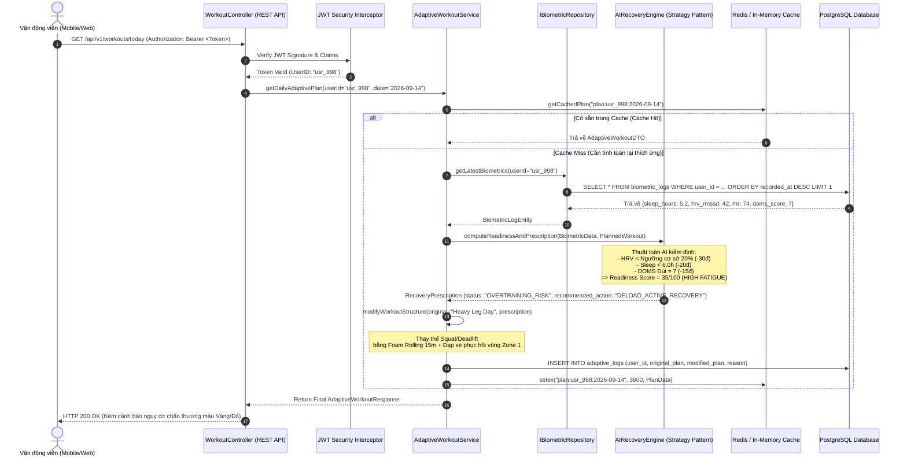
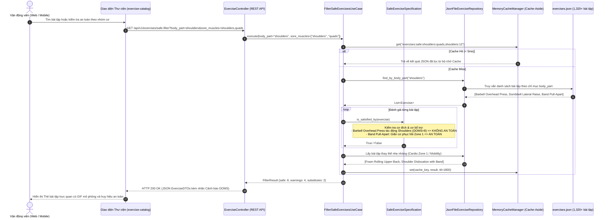
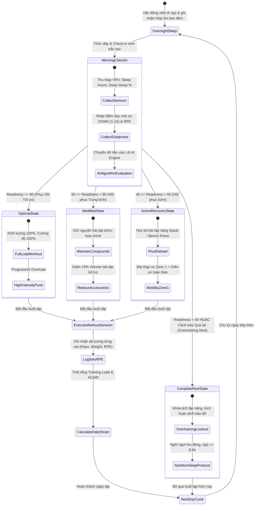
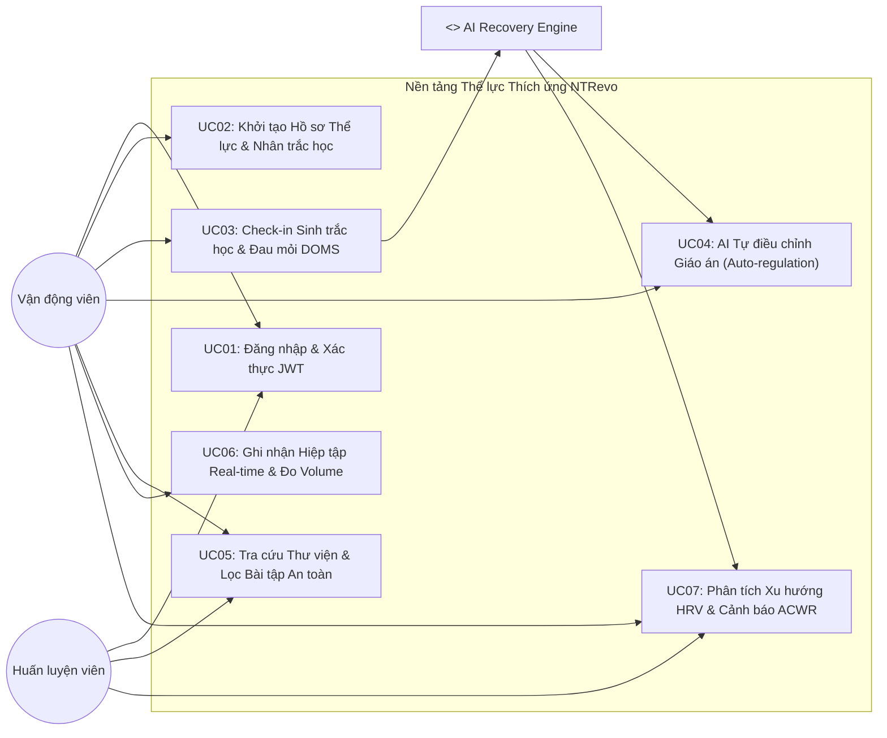

# 📐 TÀI LIỆU SƠ ĐỒ THIẾT KẾ PHẦN MỀM UML (UML DIAGRAMS)
**Dự án:** NTRevo - Adaptive Fitness & Recovery Platform  
**Học phần:** Chương 5 - AI trong Thiết kế & Kiến trúc Phần mềm  
**Người thực hiện:** Dev 2 (`Dev2-FrontendQA`)  
**Mô hình áp dụng:** Clean Architecture (Domain, UseCase, Interface Adapters, Frameworks)  

---

## 1. SƠ ĐỒ TUẦN TỰ (UML SEQUENCE DIAGRAM): LUỒNG ĐIỀU CHỈNH THÍCH ỨNG UC04

Sơ đồ thể hiện chi tiết quá trình tương tác giữa Vận động viên, Giao diện người dùng, Tầng API Gateway, Application Service, Lõi AI Recovery Engine, và Kho lưu trữ Dữ liệu khi thực thi kịch bản: **"Điều chỉnh giáo án tập luyện tức thời dựa trên sự suy giảm HRV và thiếu ngủ"**.

---

## 2. SƠ ĐỒ LỚP (UML CLASS DIAGRAM): KIẾN TRÚC THỰC THỂ & DỊCH VỤ

Sơ đồ lớp biểu diễn cấu trúc hướng đối tượng theo nguyên tắc **SOLID**, phân tách ranh giới rõ rệt giữa Domain Model, Repository Interfaces, và Application Services:

```mermaid
classDiagram
    %% Domain Entities
    class User {
        +UUID id
        +String email
        +String passwordHash
        +String fullName
        +DateTime createdAt
        +validatePassword(String rawPassword) bool
    }

    class UserProfile {
        +UUID id
        +UUID userId
        +Float weightKg
        +Float heightCm
        +Integer trainingExperienceYears
        +String primaryGoal
        +calculateBMR() Float
    }

    class BiometricLog {
        +UUID id
        +UUID userId
        +DateTime recordedAt
        +Float sleepHours
        +Integer restingHeartRate
        +Float hrvRmssd
        +Integer subjectiveStressLevel
        +isHrvDepressed(Float baselineHrv) bool
    }

    class MusclePainEntry {
        +String muscleGroup
        +Integer painLevel
        +isSevere() bool
    }

    class ReadinessScore {
        +Integer scoreValue
        +String category
        +Float confidenceLevel
        +isDeloadRecommended() bool
    }

    class WorkoutSession {
        +UUID id
        +UUID userId
        +DateTime scheduledDate
        +String workoutType
        +String status
        +List~ExerciseSet~ exerciseSets
        +calculateTotalVolume() Float
        +calculateAverageRpe() Float
    }

    class ExerciseSet {
        +Integer setNumber
        +String exerciseName
        +Float weightKg
        +Integer repsCompleted
        +Float rpe
    }

    %% Interfaces
    class IBiometricRepository {
        <<interface>>
        +save(BiometricLog log) Future~void~
        +findLatestByUserId(UUID userId) Future~BiometricLog~
        +findWeeklyHistory(UUID userId) Future~List~BiometricLog~~
    }

    class IWorkoutRepository {
        <<interface>>
        +findTodayWorkout(UUID userId) Future~WorkoutSession~
        +saveSession(WorkoutSession session) Future~void~
    }

    class IRecoveryStrategy {
        <<interface>>
        +calculateReadiness(BiometricLog bio, List~MusclePainEntry~ pains) ReadinessScore
        +generatePrescription(ReadinessScore score) WorkoutPrescription
    }

    %% Concrete Strategies
    class HighFatigueRecoveryStrategy {
        +calculateReadiness(BiometricLog bio, List~MusclePainEntry~ pains) ReadinessScore
        +generatePrescription(ReadinessScore score) WorkoutPrescription
    }

    class OptimalTrainingStrategy {
        +calculateReadiness(BiometricLog bio, List~MusclePainEntry~ pains) ReadinessScore
        +generatePrescription(ReadinessScore score) WorkoutPrescription
    }

    %% Application Service
    class AdaptiveRecoveryService {
        -IBiometricRepository biometricRepo
        -IWorkoutRepository workoutRepo
        -IRecoveryStrategy recoveryStrategy
        +evaluateTodayReadiness(UUID userId) Future~ReadinessResponse~
        +adjustWorkoutVolume(UUID userId, WorkoutSession session) Future~WorkoutSession~
    }

    %% Relationships
    User "1" *-- "1" UserProfile : owns
    User "1" o-- "*" BiometricLog : records
    User "1" o-- "*" WorkoutSession : performs
    BiometricLog "1" *-- "*" MusclePainEntry : contains
    WorkoutSession "1" *-- "*" ExerciseSet : tracks
    
    AdaptiveRecoveryService ..> IBiometricRepository : depends on
    AdaptiveRecoveryService ..> IWorkoutRepository : depends on
    AdaptiveRecoveryService ..> IRecoveryStrategy : delegates calculation to
    
    IRecoveryStrategy <|.. HighFatigueRecoveryStrategy : implements
    IRecoveryStrategy <|.. OptimalTrainingStrategy : implements
    IRecoveryStrategy ..> ReadinessScore : produces
```

---

## 3. PHÂN TÍCH NGUYÊN LÝ THIẾT KẾ ÁP DỤNG (DESIGN PATTERNS & PRINCIPLES)

1. **Strategy Pattern (`IRecoveryStrategy`, `WorkoutStrategy`):**
   - Giúp tách biệt thuật toán tính điểm phục hồi và phương pháp tập luyện (Strength, HIIT, Cardio, Mobility) ra khỏi Service chính. Khi đội ngũ AI nâng cấp công thức hoặc bổ sung môn tập mới, chỉ cần tạo Class chiến lược mới mà không sửa đổi `AdaptiveRecoveryService` (Tuân thủ nguyên tắc **Open-Closed Principle**).
2. **Factory Pattern (`WorkoutStrategyFactory`):**
   - Khởi tạo động chiến lược tập luyện dựa trên tham số `session_type` và chỉ số `Readiness Score`, giải phóng Client khỏi việc phải phụ thuộc trực tiếp vào các lớp cụ thể.
3. **Specification Pattern (`SafeExerciseSpecification`):**
   - Đóng gói quy tắc nghiệp vụ kiểm tra tính an toàn của bài tập đối với các vùng cơ bị mỏi cấp tính (DOMS >= 7) thành các đối tượng có khả năng kết hợp logic (`AND`, `OR`, `NOT`).
4. **Dependency Inversion Principle (DIP):**
   - Tầng ứng dụng cấp cao `AdaptiveRecoveryService` chỉ phụ thuộc vào các Abstractions (`IBiometricRepository`, `IWorkoutRepository`, `IExerciseRepository`), không phụ thuộc trực tiếp vào Postgres Driver hay SQLite.
5. **Single Responsibility Principle (SRP):**
   - Lớp `BiometricLog` chỉ quản lý dữ liệu đo sinh học; lớp `ReadinessScore` chỉ chịu trách nhiệm phân loại ngưỡng cảnh báo (Optimal, Moderate, Deload).

---

## 4. SƠ ĐỒ TUẦN TỰ 2 (UML SEQUENCE DIAGRAM): LUỒNG LỌC BÀI TẬP AN TOÀN UC05 (DOMS SAFE FILTERING)

Sơ đồ thể hiện quá trình vận động viên yêu cầu giáo án tập luyện khi đang bị mỏi cơ vai (Shoulders DOMS = 8):

---

## 5. SƠ ĐỒ THÀNH PHẦN (UML COMPONENT DIAGRAM): PHÂN RÃ HỆ THỐNG CLEAN ARCHITECTURE

Sơ đồ biểu diễn 4 tầng kiến trúc phần mềm, nguyên tắc phụ thuộc một chiều và các giao diện Cổng & Bộ thích ứng (Ports & Adapters):

```mermaid
graph TD
    subgraph UI_Layer ["TẦNG 4: FRAMEWORKS & INFRASTRUCTURE (Tầng ngoài cùng)"]
        UI_Web["Web Frontend (HTML5 / Vanilla CSS / Glassmorphism)"]
        SwaggerUI["Swagger UI (swagger.html)"]
        NodeServer["Node.js / Python HTTP Server Gateway"]
        CacheDriver["MemoryCacheManager (In-Memory / Redis)"]
        DatabaseEngine["SQLite / PostgreSQL (Chuẩn 3NF)"]
        DatasetStore["exercises.json (1,320+ Dataset)"]
    end

    subgraph Adapters_Layer ["TẦNG 3: INTERFACE ADAPTERS"]
        ExerciseCtrl["ExerciseController"]
        RecoveryCtrl["RecoveryController"]
        WorkoutCtrl["WorkoutController"]
        ExerciseRepoImpl["JsonFileExerciseRepository"]
        BiometricRepoImpl["InMemoryBiometricRepository"]
        WorkoutRepoImpl["InMemoryWorkoutRepository"]
        DTOs["ExerciseDTO / ReadinessDTO Serializers"]
    end

    subgraph UseCases_Layer ["TẦNG 2: APPLICATION BUSINESS RULES (USE CASES)"]
        FilterSafeUC["FilterSafeExercisesUseCase"]
        CalcReadinessUC["CalculateReadinessUseCase"]
        GenWorkoutUC["GenerateAdaptiveWorkoutUseCase"]
        IExerciseRepo["<<interface>> IExerciseRepository"]
        IBiometricRepo["<<interface>> IBiometricRepository"]
        IWorkoutRepo["<<interface>> IWorkoutRepository"]
        ICachePort["<<interface>> ICacheService"]
    end

    subgraph Domain_Layer ["TẦNG 1: ENTERPRISE BUSINESS RULES (DOMAIN CORE)"]
        ExerciseEntity["Exercise Entity"]
        AthleteEntity["Athlete / User Entity"]
        BiometricEntity["BiometricSample Entity"]
        WorkoutEntity["WorkoutSession Entity"]
        ReadinessEntity["ReadinessScore Entity"]
        SafeSpec["SafeExerciseSpecification"]
        WorkoutStrategyBase["<<abstract>> WorkoutStrategy"]
        StrategyFactory["WorkoutStrategyFactory"]
    end

    %% Dependencies (Outside-In)
    UI_Web --> NodeServer
    SwaggerUI --> NodeServer
    NodeServer --> ExerciseCtrl
    NodeServer --> RecoveryCtrl
    NodeServer --> WorkoutCtrl

    ExerciseCtrl --> FilterSafeUC
    RecoveryCtrl --> CalcReadinessUC
    WorkoutCtrl --> GenWorkoutUC
    ExerciseCtrl --> DTOs

    FilterSafeUC --> IExerciseRepo
    FilterSafeUC --> ICachePort
    CalcReadinessUC --> IBiometricRepo
    CalcReadinessUC --> ICachePort
    GenWorkoutUC --> IWorkoutRepo

    ExerciseRepoImpl -.->|implements| IExerciseRepo
    BiometricRepoImpl -.->|implements| IBiometricRepo
    WorkoutRepoImpl -.->|implements| IWorkoutRepo
    CacheDriver -.->|implements| ICachePort

    ExerciseRepoImpl --> DatasetStore
    BiometricRepoImpl --> DatabaseEngine
    WorkoutRepoImpl --> DatabaseEngine

    FilterSafeUC --> SafeSpec
    FilterSafeUC --> ExerciseEntity
    CalcReadinessUC --> BiometricEntity
    CalcReadinessUC --> ReadinessEntity
    GenWorkoutUC --> StrategyFactory
    GenWorkoutUC --> WorkoutStrategyBase
    GenWorkoutUC --> WorkoutEntity

    style Domain_Layer fill:#27272A,stroke:#FF4500,stroke-width:2px,color:#FAFAFA
    style UseCases_Layer fill:#18181B,stroke:#3B82F6,stroke-width:2px,color:#FAFAFA
    style Adapters_Layer fill:#18181B,stroke:#10B981,stroke-width:2px,color:#FAFAFA
    style UI_Layer fill:#09090B,stroke:#64748B,stroke-width:2px,color:#FAFAFA
```

---

## 6. SƠ ĐỒ MÁY TRẠNG THÁI (UML STATE MACHINE DIAGRAM): VÒNG ĐỜI TRẠNG THÁI PHỤC HỒI & QUẢN TRỊ NGUY CƠ

Sơ đồ thể hiện chu trình tự điều chỉnh trạng thái tập luyện hàng ngày của Vận động viên:

---

## 7. SƠ ĐỒ CA SỬ DỤNG TỔNG QUAN (UML USE CASE DIAGRAM)

